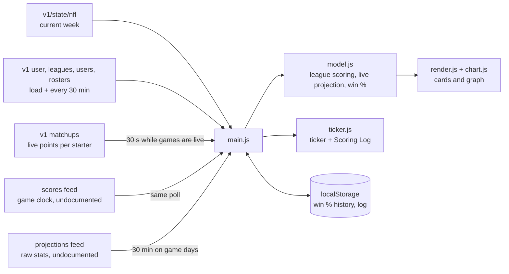

# Live Matchups

A glanceable scoreboard for my Sleeper fantasy football matchups, built to sit on
a 1920×1080 second monitor all day. It's a static page with no backend and no
build step; it talks to Sleeper's public API straight from the browser.

Each league gets a card with:

- the live score (large), projected final, and estimated win probability
- a win-probability graph across the fantasy week
- a small "live / to play / final" pip row per team

Across the bottom, a ticker announces scoring plays one at a time, and the
**Scoring Log** button opens the week's plays, newest first.

## Run it

```sh
make serve      # http://localhost:8000
make test       # unit tests (Node built-in runner, no dependencies)
make verify-scoring   # compare our league scoring against Sleeper's live per-player points
```

Another Sleeper user: append `?user=<username>`. Short league names for the
ticker live in `js/config.js`.

## Deploy (GitHub Pages)

Settings → Pages → Build and deployment → *Deploy from a branch* → `main` / `/ (root)`.
The page is then served at `https://<owner>.github.io/ffvisual/`. A free GitHub
plan requires the repository to be public for Pages.

## How it works



- **Polling** adapts to the schedule:
  - every 30 s while any game is live
  - every minute when kickoff is imminent
  - up to 5 min on game days
  - 15 min otherwise

  The page also reloads itself at 5 AM to pick up deploys and the new week.
- **Projections** are computed from the projected raw stats times each league's
  own `scoring_settings`, since the two leagues score differently.
  `make verify-scoring` checks that same scoring code against Sleeper's
  official per-player points. Yardage-threshold bonuses (e.g. 100-yard games)
  can't be projected from average stats, so projections run slightly low in
  leagues that use them. Actual points always come from Sleeper.
- **Win probability (estimated)** is our calculation, not Sleeper's.
  - Each starter contributes actual points plus projection × share of their game
    remaining.
  - Uncertainty per player is `(2·√projection + 1)` points, scaled by
    `√share remaining`.
  - The margin is treated as normally distributed.
- **Graph time axis** is compressed "football time": game windows (Thu night,
  Sunday, Monday night, ...) are laid end to end and the dead time between them
  is collapsed.
- **History** is recorded only while the page is open, as runs of unchanged
  values in `localStorage`.
  - If the page goes quiet longer than its poll schedule allows (closed,
    asleep, offline), that span is drawn as a hatched gap, never as a line.
  - Where possible, the graph adds hollow, unconnected *reconstructed* points:
    a pregame estimate, and the state after each window of games went final.
    These use final stats plus current projections.
- **Scoring events** come from comparing each starter's points between polls.
  - Small yardage gains accumulate per player until they reach 1 point.
  - After a long pause, the page rebaselines instead of replaying a burst.

## When things fail

- The `api.sleeper.app/v1` endpoints are documented. The game-clock and
  projections feeds on `api.sleeper.com` are not.
- If either undocumented feed fails, live scores keep working. The projected
  final, win probability, and graph are hidden, and the card says why.
- Player names fall back to Sleeper's documented players list when the
  projections feed is down.
- If Sleeper is unreachable entirely, the page keeps the last data on screen,
  marks it stale, and retries with backoff.
